1\. Project (Synopsis) Title

# **Personalized E-Learning Dashboard with PDF Progress Tracking and AI-Powered Q&A**

# Table of Contents

1. Project Title and Category
1. Introduction and Objectives
1. Problem Definition and Literature Review
1. Technical Specifications
1. System Analysis and Design
1. Database Design
1. System Architecture
1. Implementation Strategy
1. Security Implementation
1. Project Scheduling
1. Future Scope
1. Glossary
1. Bibliography
1. **Project Title**

Personalized E-Learning Dashboard with PDF Progress Tracking and

AI-Powered Q&A

2. **Project Category**

Primary Category: Web Application Development

Secondary Categories: Data Science / Artificial Intelligence RDBMS (Relational

Database Management System) User Interface Design

3. **Domain Focus**

Educational Technology (EdTech) with AI Integration

# 2\. Introduction and Objectives

1. **Project Introduction**

With the rise of self-paced and remote learning, students increasingly rely on digital documents for study. However, most platforms focus on video content, leaving a gap for those who prefer or require document-based learning. For example, a student preparing for competitive exams may have dozens of PDFs but no way to track progress or get instant help with doubts. The Personalized E-Learning Dashboard addresses this by providing a unified platform for PDF management, progress tracking, and AI-powered Q&A.

The platform addresses the growing need for personalized learning experiences by providing detailed analytics on study patterns and offering immediate assistance through

advanced natural language processing.

2. **Primary Objectives**
1. **Progress Tracking:** Enable users to upload and view subject-wise PDFs while maintaining detailed reading progress
1. **Visual Analytics:** Provide interactive charts and visualizations for progress monitoring
1. **AI Integration:** Implement context-aware question-answering capabilities for PDF content
1. **User Experience:** Ensure secure, intuitive, and responsive user interface
1. **Data Management:** Maintain robust data storage and retrieval mechanisms
1. **Secondary Objectives**

- Scalable architecture for future enhancements
- Multi-user support with role-based access control
- Comprehensive reporting and analytics
- Cross-platform compatibility

3\. Problem Definition and Literature Review

1. **Problem Statement**

Traditional e-learning platforms lack comprehensive progress tracking for document based learning materials. Students often struggle with:

- Inability to track reading progress across multiple subjects
- Lack of instant help for doubts while studying
- Absence of visual progress indicators
- Difficulty in organizing study materials effectively

2. **Existing System Analysis**

Current e-learning platforms (Coursera, Udemy, Khan Academy) primarily focus on video content but lack:

- Detailed PDF reading analytics
- Context-aware Q&A systems
- Personalized progress visualization
- Subject-wise organization of documents

3. **Proposed Solution Benefits**

- **Personalized Learning:** Tailored progress tracking per subject
- **Instant Support**: AI-powered doubt resolution
- **Visual Feedback:** Real-time progress charts and analytics
- **Organized Learning:** Systematic subject-wise content management

4. **Recent Literature Reference**

16\. Wang, Y., Li, X., & Chen, Z. (2023). "AI-driven adaptive learning systems: A review of recent advances and future directions." Computers & Education: Artificial Intelligence, 4, 100123.

4. Technical Specifications
1. **Technology Stack**
1. **Frontend Technologies**
   1. **Framework**: ReactJS (v18+)
   1. **Styling**: HTML5, CSS3, SCSS, Tailwind CSS
   1. **Visualization**: Chart.js (v4+)
   1. **PDF Handling**: PDF.js (v3+) or react-pdf (v7+)
1. **Backend Technologies**
   1. **Runtime**: Node.js (v18+)
   1. **Framework**: Express.js (v4+)
   1. **API Design**: RESTful APIs
1. **Database**

- Primary Options: MongoDB (v6+) or PostgreSQL (v15+)
- Selection Criteria: Based on scalability requirements

4. **AI/ML Components**

- Language: Python (3.10+)
- Framework: Flask (v2+) or FastAPI (v0.95+)
- AI Library: Hugging Face Transformers (v4.30+)
- PDF Processing: pdfplumber (v0.10+) or PyPDF2 (v3+)

5. **Deployment and DevOps**

- Version Control: Git (v2.40+)
- Development Environment: VS Code (v1.80+)

2. **Hardware Requirements**

- Minimum: Standard PC/Laptop with 8GB RAM
- Recommended: 16GB RAM for AI model processing
- Network: Stable internet connection for cloud services

3. **Software Requirements**

- Development: Node.js, Python 3.x, Git
- Database: MongoDB/PostgreSQL server
- Browser: Modern web browsers (Chrome, Firefox, Safari)

5. ## System Analysis and Design
1. **Context Level DFD (Level 0)**

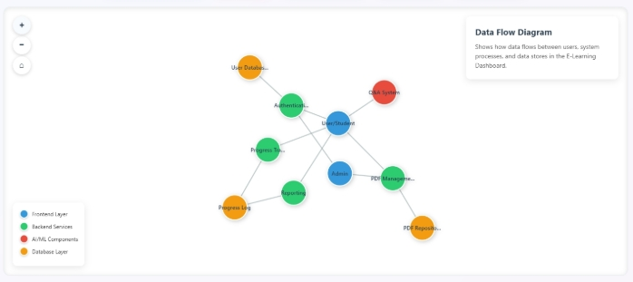

2. **Level 1 DFD**

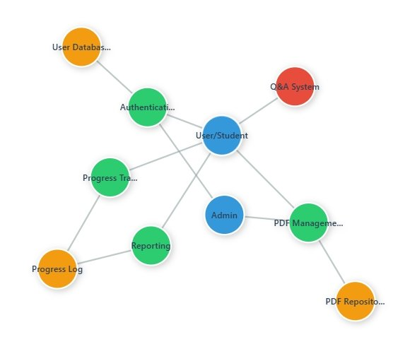

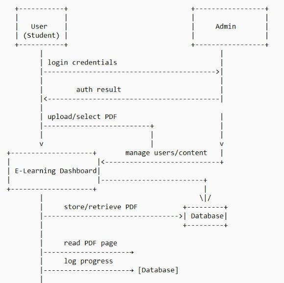

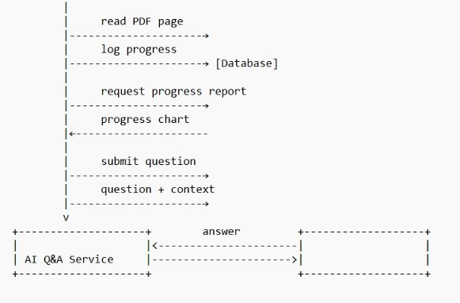

**5.2.1 Level 2 DFD: PDF Reading & Progress Tracking**

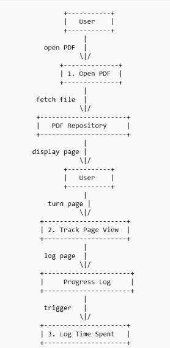

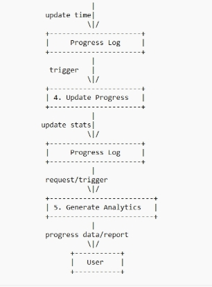

3. **Use Case Diagram**

- Student

`  `├── Register/Login

`  `├── Manage Profile

`  `├── Upload PDF

`  `├── View PDF

`  `├── Track Reading Progress ├── View Progress Charts

`  `├── Ask Questions

`  `├── Receive AI Answers

`  `└── Download Reports

- System

`  `└── Process AI Queries <--> AI Q&A Service

4. **Activity Diagram: Question-Answer Flow**

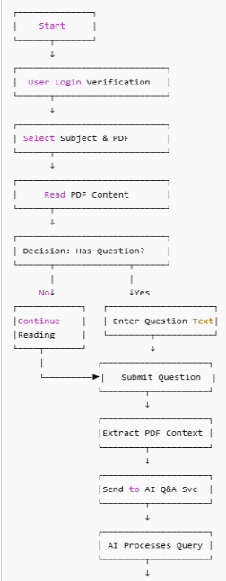 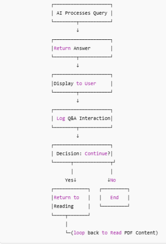

5. **UML Sequence Diagram: AI Q&A Process**

Participants: User, Web App, Application Server, AI Service, Database

Sequence:

User -> Web App -> Application Server -> Database -> Application Server -> AI Service -> Application Server -> Application Server -> Web App ->

Web App: Submit question

Application Server: Send question + PDF context Database: Fetch PDF metadata

Application Server: Return PDF details

AI Service: Process question with context Application Server: Return generated answer Database: Log Q&A interaction

Web App: Send answer

User: Display answer

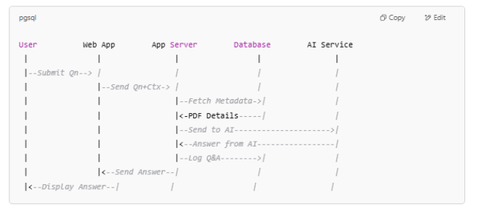 6. ## **Database Design**

1. **Entity Relationship Diagram (ERD)**

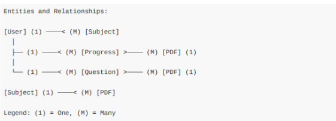

**Cardinality:**

- One User can have many Subjects
- One Subject can have many PDFs
- One User can have many Progress records (each for a PDF)
- One PDF can have many Progress records (for different users)
- One User can ask many Questions (each for a PDF)
- One PDF can have many Questions (from different users)

2. **Database Schema**
1. **Users Table**

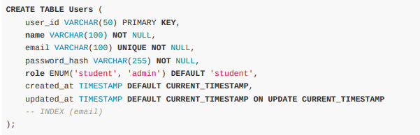

2. **Subjects Table CREATE TABLE**

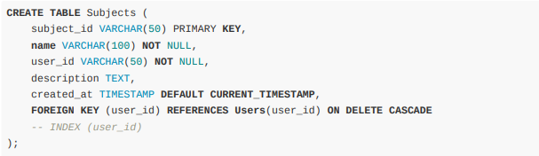

3. **PDFs Table**

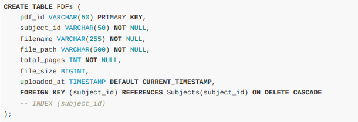

4. **Progress Table**

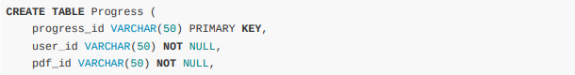

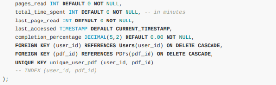

5. **Questions Table**

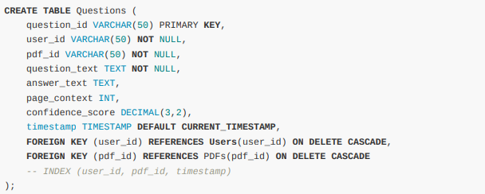

3. **Database Indexes and Constraints**

- Primary keys for all tables
- Foreign key constraints with cascade delete
- Unique constraints on email and user-pdf combinations
- Indexes on frequently queried columns (user_id, pdf_id, timestamp)
- All fields marked NOT NULL where appropriate

7. ## System Architecture
1. **Overall System Architecture**

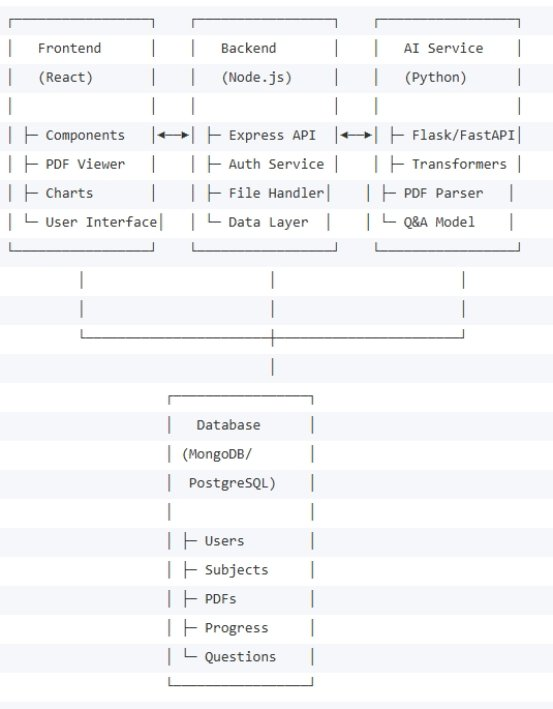 2. ## **Component Architecture**

1. #### **Frontend Components**

- Authentication Components: Login, Register, Profile
- Dashboard Components: Main dashboard, Subject overview
- PDF Components: PDF viewer, Progress tracker
- Visualization Components: Charts, Reports
- Q&A Components: Question input, Answer display

2. #### **Backend Services**

- Authentication Service: JWT-based auth, Session management
- File Management Service: PDF upload, Storage, Retrieval
- Progress Service: Reading analytics, Progress calculation
- Q&A Service: Question processing, AI integration

3. #### **AI Service Components**

- PDF Parser: Extract text and context from PDFs
- Question Processor: Natural language understanding
- Answer Generator: Context-aware response generation
- Model Manager: AI model loading and optimization

8. ## Implementation Strategy
1. ### **System Modules**
1. #### **Module 1: User Authentication & Management**
   **Purpose**: Handle user registration, login, and profile management **API Endpoints:**

- POST /api/auth/register
- POST /api/auth/login
- GET /api/user/profile
- PUT /api/user/profile

**Data Structures:**

User: {

`  `userId: String,

`  `name: String,

`  `email: String,

`  `passwordHash: String, role: String,

`  `createdAt: Date

}

**Process Logic:**

1. User submits registration/login form
1. Server validates credentials
1. Generate JWT token for authenticated users
1. Store session information
1. Redirect to dashboard
1. **Module 2:** PDF Upload & Management

**Purpose**: Handle PDF file operations and metadata storage Effort Estimate: 2 weeks, ~250 LOC API

**Endpoints:**

- POST /api/pdf/upload
- GET /api/pdf/:id
- GET /api/pdf/subject/:subjectId
- DELETE /api/pdf/:id

**Data Structures:** PDF: {

`  `pdfId: String,

`  `subjectId: String,

`  `filename: String,

`  `filePath: String,

`  `totalPages: Number, fileSize: Number,

`  `uploadedAt: Date

}

**Process Logic:**

1. User selects PDF file
1. Validate file type and size
1. Extract metadata (pages, text content)
1. Store file and metadata
1. Update subject association
1. #### **Module 3:** Progress Tracking
   **Purpose**: Monitor and record user reading progress

**API Endpoints:**

- POST /api/progress/update
- GET /api/progress/:userId/:pdfId
- GET /api/progress/summary/:userId

**Data Structures:**

Progress: {

`  `progressId: String,

`  `userId: String,

`  `pdfId: String,

`  `pagesRead: Number,

`  `totalTimeSpent: Number,

`  `lastPageRead: Number,

`  `completionPercentage: Number, lastAccessed: Date

}

**Process Logic:**

1. Track page views and time spent
1. Calculate progress metrics
1. Update progress records
1. Generate completion statistics
1. #### **Module 4:** Progress Visualization
   **Purpose**: Display progress data through interactive charts **API Endpoints:**

- GET /api/progress/charts/:userId

**Data Structures:** ChartData: {

`  `labels: Array<String>,

`  `datasets: Array<{

`    `label: String,

`    `data: Array<Number>,

`    `backgroundColor: String, borderColor: String

`  `}>

} 5. #### **Module 5: AI Q&A Service**
**Purpose**: Provide intelligent question-answering capabilities

**API Endpoints:**

- POST /api/qa/ask
- GET /api/qa/history/:userId

**Data Structures:**

Question: {

`  `questionId: String,

`  `userId: String,

`  `pdfId: String,

`  `questionText: String,

`  `answerText: String,

`  `pageContext: Number,

`  `confidenceScore: Number, timestamp: Date

}

**Process Logic:**

1. Receive user question
1. Extract relevant PDF context
1. Send to AI model for processing
1. Return generated answer
1. Log interaction for analysis
1. #### **Module 6: Admin Dashboard**
   **Purpose**: System administration and monitoring **API Endpoints:**

- GET /api/admin/users
- PUT /api/admin/user/:id
- DELETE /api/admin/user/:id
- GET /api/admin/reports

2. ### **Implementation Methodology**

   **Approach**: Agile development with iterative releases **Phases**:

1. Sprint 1-2: Core authentication and basic PDF handling
1. Sprint 3-4: Progress tracking and visualization
1. Sprint 5-6: AI Q&A integration
1. Sprint 7-8: Admin features and optimization
1. Sprint 9-10: Testing and deployment
1. ### **Expected Reports**
1. User Progress Reports: Individual and comparative progress (PDF, CSV, on-screen)
1. Subject Analytics: Performance across different subjects (on-screen, PDF)
1. Q&A Logs: Question patterns and answer accuracy (CSV, on-screen)
1. System Usage Reports: Platform utilization statistics (on-screen, PDF)
1. Admin Reports: User management and system health (PDF)
1. ## Security Implementation
1. ### **Authentication Security**

- **JWT Tokens:** Secure token-based authentication
- **Password Hashing:** bcrypt for password security
- **Session Management**: Secure session handling

2. ### **Data Security**

- **Input Validation:** Comprehensive input sanitization
- **SQL Injection Prevention:** Parameterized queries
- **XSS Protection:** Content Security Policy implementation
- **File Upload Security:** File type validation and virus scanning

3. ### **API Security**

- **Rate Limiting:** Prevent API abuse
- **CORS Configuration:** Cross-origin request security
- **HTTPS Enforcement:** SSL/TLS encryption
- **API Authentication:** Secure API endpoint access

4. ### **Database Security**

- **Data Encryption:** Sensitive data encryption at rest
- **Access Control:** Role-based database permissions
- **Backup Security:** Encrypted backup storage

5. ### **Security Audits and Virus Scanning**

- **Regular Security Audits:** Conduct periodic security reviews and vulnerability assessments
- **OWASP Compliance:** Follow OWASP Top 10 guidelines
- **Virus/Malware Scanning:** All uploaded files are scanned for viruses/malware before storage

10. ## Project Scheduling
1. ### **Gantt Chart Overview**
   Week Phase Tasks Deliverables 

1-2 Analysis Requirements, SRS, System Design Documentation, Diagrams 3-4 Frontend React setup, PDF viewer, UI Working frontend prototype

components

5-6 Backend API development, Database setup Backend services, Database

7-8 Features Progress tracking, Visualization Core functionality 9-10 AI Integration Q&A service, Model integration AI-powered features

11-12 Testing Integration testing, Deployment Complete system

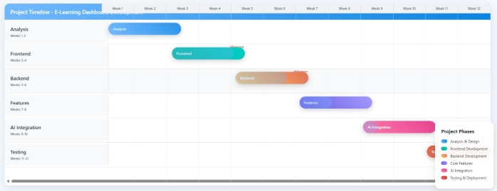 2. ### **Critical Path Analysis (PERT)**
**Critical Path:** Requirements → Design → Backend → AI Integration → Testing **Total Duration:** 12 weeks

**Critical Tasks:** Database design, AI service integration, System testing 3. ### **Risk Management**

- **Technical Risks**: AI model performance, Scalability issues
- **Resource Risks**: Development time, Modal optimization time
- **Mitigation Strategies**: Regular testing, Backup plans, Agile methodology

11. ## **Future Scope**
1. ### **Immediate Enhancements**

- **Mobile Application**: iOS and Android app development
- **Video Integration:** Support for video lectures alongside PDFs
- **Quiz Generation**: AI-powered quiz creation from PDF content
- **Collaborative Features**: Study groups and shared progress

2. ### **Advanced Features**

- **Personalized Recommendations:** AI-driven study suggestions
- **Voice Integration:** Voice-to-text questions and audio answers
- **Advanced Analytics:** Machine learning-based learning pattern analysis
- **Multi-language Support:** Internationalization for global users

3. ### **Scalability Improvements**

- **Cloud Integration:** AWS/Azure deployment
- **Microservices Architecture:** Service-oriented architecture
- **CDN Integration:** Global content delivery
- **Real-time Features:** WebSocket-based real-time updates

4. ### **LMS Integration**

- **Learning Management System (LMS) Integration:** Enable interoperability with popular LMS platforms (e.g., Moodle, Canvas) for broader adoption and data exchange

12. ## Glossary

- **PDF**: Portable Document Format
- **Q&A**: Question and Answer
- **DFD**: Data Flow Diagram
- **ERD**: Entity Relationship Diagram
- **API**: Application Programming Interface
- **JWT**: JSON Web Token
- **LMS**: Learning Management System
- **MVP**: Minimum Viable Product
- **LOC**: Lines of Code
- **OWASP**: Open Web Application Security Project

## 14\. Bibliography

1. ### **Academic References**
1. Devlin, J., Chang, M. W., Lee, K., & Toutanova, K. (2018). “BERT: Pre-training of Deep Bidirectional Transformers for Language Understanding.” arXiv preprint arXiv:1810.04805.
1. Rogers, A., Kovaleva, O., & Rumshisky, A. (2020). “A primer on neural network models for natural language processing.” Journal of Artificial Intelligence Research, 57, 615-732.
1. Anderson, L. W., & Krathwohl, D. R. (2001). “A taxonomy for learning, teaching, and assessing: A revision of Bloom’s taxonomy of educational objectives.” New York: Longman.
1. Wang, Y., Li, X., & Chen, Z. (2023). “AI-driven adaptive learning systems: A review of recent advances and future directions.” Computers & Education: Artificial Intelligence, 4, 100123.
1. ### **Technical Documentation**
1. ReactJS Official Documentation. (2024). <https://react.dev/>
1. Node.js Documentation. (2024). <https://nodejs.org/en/docs/>
1. Hugging Face Transformers Documentation. (2024). <https://huggingface.co/transformers/>
1. MongoDB Documentation. (2024). <https://docs.mongodb.com/>
1. Express.js Documentation. (2024). <https://expressjs.com/>
1. ### **Libraries and Tools**
1. PDF.js Documentation. <https://mozilla.github.io/pdf.js/>
1. Chart.js Documentation. <https://www.chartjs.org/docs/>
1. pdfplumber Documentation. <https://github.com/jsvine/pdfplumber>
1. [JWT.io](http://jwt.io/) Documentation. <https://jwt.io/introduction/>
1. ### **Research Papers**
1. Zawacki-Richter, O., Marín, V. I., Bond, M., & Gouverneur, F. (2019). “Systematic review of research on artificial intelligence applications in higher education.” International Journal of Educational Technology in Higher Education, 16(1), 39.
1. Chen, L., Chen, P., & Lin, Z. (2020). “Artificial Intelligence in Education: A Review.” IEEE Access, 8, 75264-75278.
1. Luckin, R., Holmes, W., Griffiths, M., & Forcier, L. B. (2016). “Intelligence Unleashed: An argument for AI in Education.” London: Pearson.
